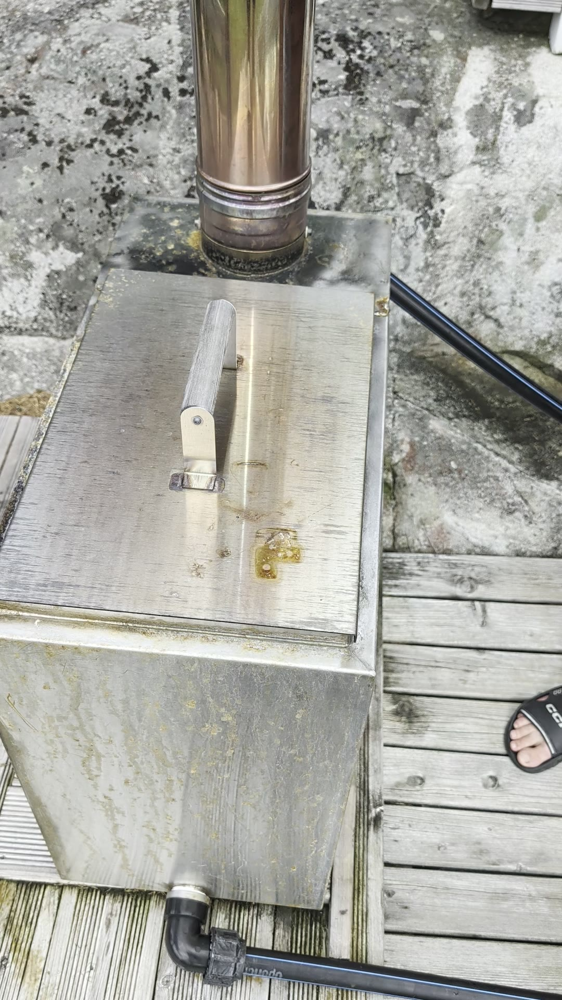
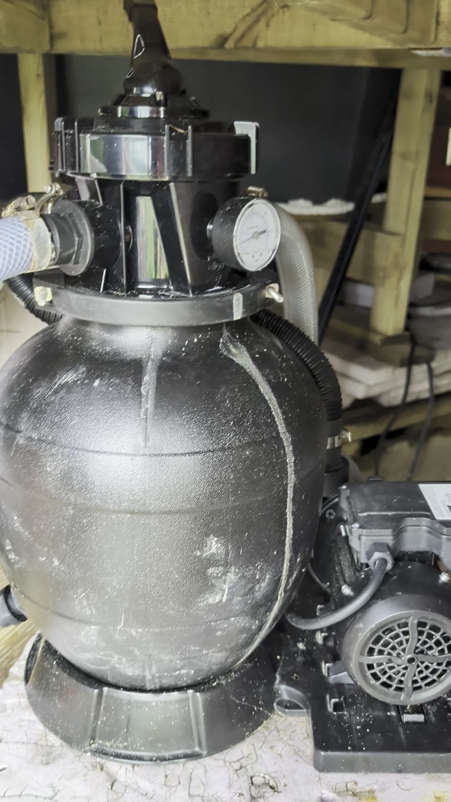
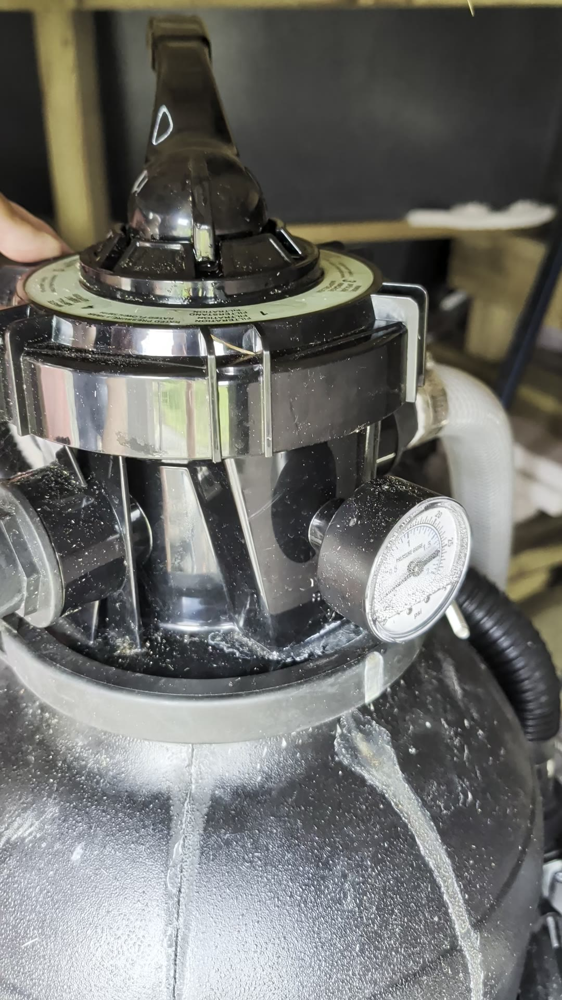
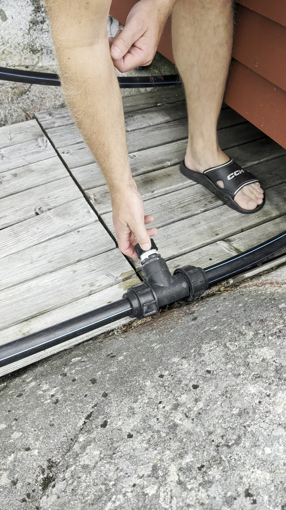

Guide till badtunnan: hur man fyller på och värmer upp den, hur man rengör filtret och hur man förbereder allt inför vintern.

Badtunnan värms av en vedeldad kamin bredvid tunnan. Vattnet cirkuleras av en pump med filterbehållare som står under altanen, och pumpen styrs av en timer.

## Fylla på vatten

När tunnan är tom fyller man på med vattenslangen direkt ner i tunnan.

## Värma upp badtunnan

1. Gör upp en eld i kaminen.
2. Se till att pumpen går **hela tiden** medan man eldar, så att vattnet cirkulerar genom kaminen och hela tunnan värms upp.

För att pumpen ska gå hela tiden trycker man på den **röda knappen** på timern som sitter under altanen (inte på pumpen!). Då kopplas timern ur och pumpen går i permanent drift.

::: {.callout-note}
## När man inte eldar
När tunnan är fylld men inte används står pumpen på timer och går lite då och då. Det håller vattnet i rörelse så att det inte blir smutsigt.
:::

## Filtret

Pumpen och filtret står under altanen, bakom en lucka i panelen.

Ovanpå filterbehållaren sitter ett vred med flera lägen. De två viktigaste är:

- **Filtration**: det vanliga läget när badtunnan är i drift.
- **Backspolning** (*Backwash/Rinse*): spolar filtret baklänges och blåser ur smutsen ur filterbollarna.

### Så här backspolar man filtret

1. Lyft upp spaken på vredet och vrid till backspolningsläget.
2. Låt pumpen gå. Det rinner ut en hel del vatten när smutsen spolas ur filtret.
3. Vrid tillbaka till **Filtration** när du är klar.

::: {.callout-tip}
## Hur ofta?
Det behövs inte när man precis har startat upp för säsongen, eftersom allt då är rent. Backspola i stället när tunnan har använts ett tag, till exempel någon gång mitt i sommaren.
:::

## Inför vintern

### Tömma ledningarna och kaminen

1. Öppna avtappningsventilen på ledningen vid kaminen. Vattnet kommer ut med tryck.
2. Ta av locket på avtappningen så att resten av vattnet rinner ut.
3. Koppla loss slangarna från kaminen och låt allt vatten i kaminen rinna ut.
4. Kontrollera att kaminen är helt tom, och bär sedan in den under byggnaden.

Själva rören kan ligga kvar ute över vintern.

### Pump och filter

1. Koppla loss de tre slangarna från pumpen och filterbehållaren.
2. Skruva av de två skruvarna och öppna filterbehållaren.
3. Ta ur filterbollarna. Spola av dem så gott det går, och låt dem torka så att de är redo till nästa säsong. Man kan också köpa nya filterbollar.
4. Bär in pumpen och filtret och ställ dem inomhus under altanen, vid [varmvattenberedaren](varmvattenberedare.qmd).

::: {.callout-note}
## Filterbollar eller sand?
Filtret går också att köra med filtersand, men filterbollarna har fungerat mycket bättre.
:::
