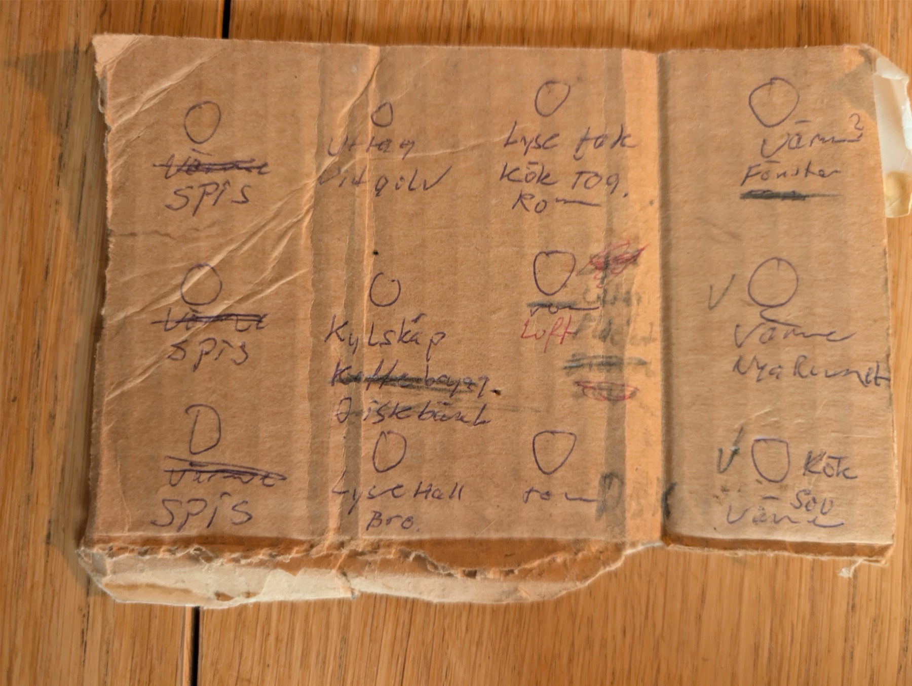
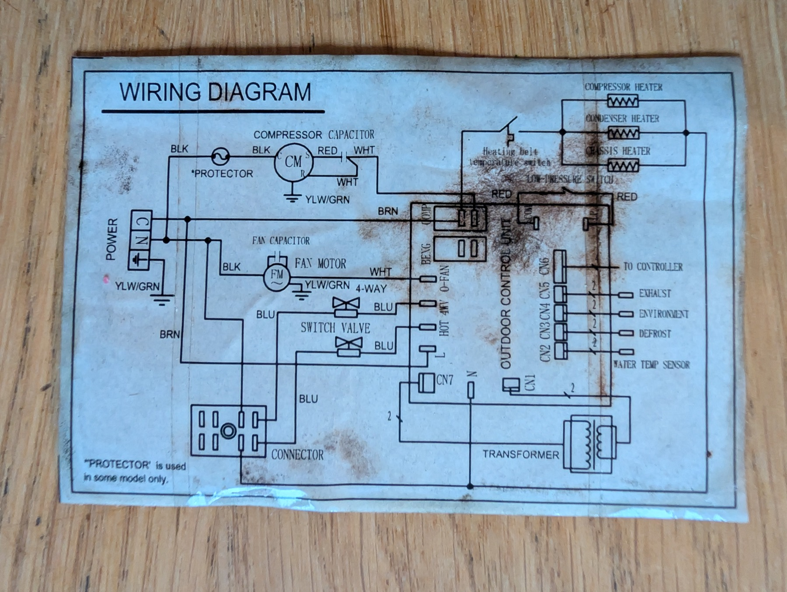

Guide till de två kopplingsscheman som finns: det handskrivna säkringsschemat och kopplingsschemat (wiring diagram) för en värmepumps utedel.

## Säkringsschemat {#sakringar}

Säkringsschemat är handskrivet på en bit kartong. Det visar säkringarna i **fyra kolumner med tre säkringar i varje**. Flera rader är överstrukna och har skrivits om, så schemat har uppdaterats över tid.

{.wide}

Tolkning av schemat, i samma ordning som på kartongen (överstruken text är utelämnad):

| Rad | Kolumn 1 | Kolumn 2 | Kolumn 3 | Kolumn 4 |
|---|---|---|---|---|
| **Överst** | Spis | Uttag vid golv | Belysning tak: kök, toa, rum | Värme fönster |
| **Mitten** | Spis | Kylskåp, diskbänk | **Luft** | Värme nya rummet |
| **Nederst** | Spis | Belysning hall, bro | Tom | Kök–sov värme |

- **"Luft"** är skrivet i rött och har ersatt en äldre text. Det är troligen säkringen till [luftvärmepumpen](luftvarmepump.qmd).

## Kopplingsschema för värmepumpens utedel

Det andra schemat är en tryckt dekal med rubriken **Wiring diagram**. Den visar hur utedelen till en värmepump är kopplad. Det står inte på dekalen vilken maskin den hör till. Att den har en givare för vattentemperatur (*water temp sensor*) kan betyda att det är [luftvarmvattenberedarens](luftvarmvattenberedare.qmd) utedel.

{.wide}

### Komponenter

| På schemat | På svenska | Funktion |
|---|---|---|
| Power (L, N, jord) | Matning | Inkommande ström: fas (L), nolla (N) och jord |
| CM, compressor | Kompressor | Pumpar runt köldmediet |
| Compressor capacitor | Kompressorkondensator | Hjälper kompressorn att starta |
| Protector | Motorskydd | Skyddar kompressorn (finns bara på vissa modeller) |
| FM, fan motor | Fläktmotor | Driver utedelens fläkt |
| Fan capacitor | Fläktkondensator | Hjälper fläktmotorn att starta |
| 4-way valve | Fyrvägsventil | Växlar köldmediets riktning, t.ex. vid avfrostning |
| Switch valve | Magnetventil | Öppnar och stänger ett köldmedieflöde |
| Compressor / condenser / chassis heater | Värmare för kompressor, kondensor och chassi | Värmekablar som håller delarna varma när det är kallt |
| Heating belt temperature switch | Termostat för värmekablarna | Slår på värmarna ovan när det blir kallt |
| Low-pressure switch | Lågtrycksvakt | Stänger av om trycket i köldmediet blir för lågt |
| Outdoor control unit | Styrkort | Styr allt i utedelen |
| Transformer | Transformator | Ger lågspänning till styrkortet |
| Connector | Kopplingsplint | Anslutning mellan utedelen och resten av systemet |
| To controller (CN6) | Till styrningen | Kabel till displayen/manöverpanelen |

### Givare (temperatursensorer)

Givarna sitter på styrkortets kontakter CN2–CN5:

| På schemat | På svenska |
|---|---|
| Exhaust | Hetgas (temperatur efter kompressorn) |
| Environment | Utomhustemperatur |
| Defrost | Avfrostning (förångarens temperatur) |
| Water temp sensor | Vattentemperatur |

### Kabelfärger

| Förkortning | Färg |
|---|---|
| BLK | Svart |
| BRN | Brun |
| BLU | Blå |
| RED | Röd |
| WHT | Vit |
| YLW/GRN | Gul/grön (jord) |

::: {.callout-important}
## Elarbete
Schemat är till för att man ska förstå hur utedelen är uppbyggd. Arbete i elinstallationen ska göras av en behörig elektriker.
:::
