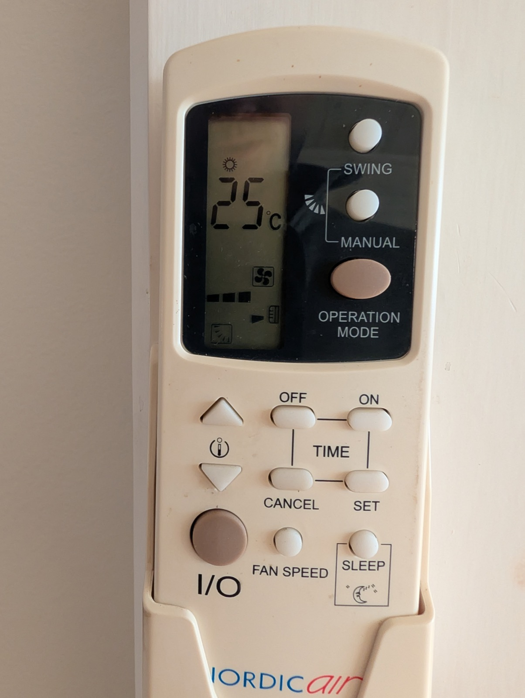

## Värme: sol-läget ☀️

Luftvärmepumpen styrs med fjärrkontrollen (Nordic Air). För att den ska **värma** måste **sol-läget ☀️** vara aktivt.

1. Tryck på **OPERATION MODE** tills **solsymbolen ☀️** syns uppe till vänster i displayen.
2. Ställ in önskad temperatur med pilknapparna **▲ / ▼**.
3. Slå på och av med **I/O**-knappen.

::: {.callout-warning}
## Undvik kyla ❄️
Använd **inte** luftvärmepumpen för att kyla. En av ledningarna är **inte isolerad**. Vid kylning kan det bildas **kondens** på den, vilket kan ge **vattenskador**.
:::

::: {.callout-note}
## Säkring
På säkringsschemat i elcentralen är luftvärmepumpens säkring märkt **"Luft"**, se [Kopplingsschema](kopplingsschema.qmd#sakringar).
:::
