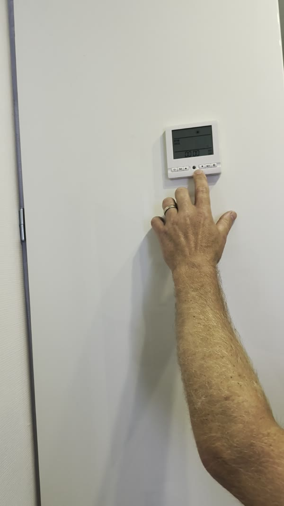
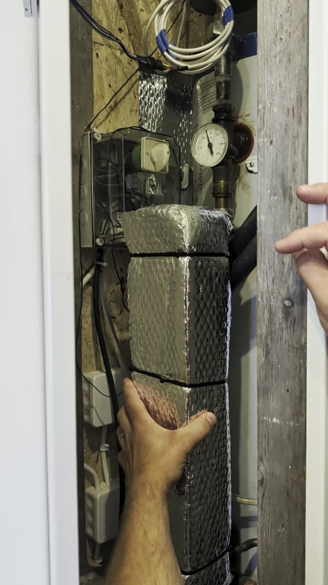
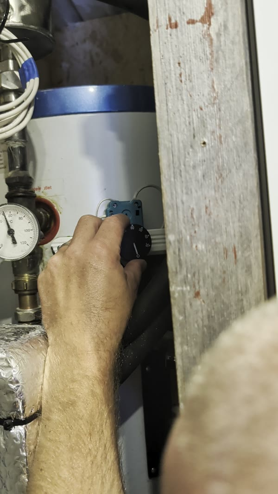
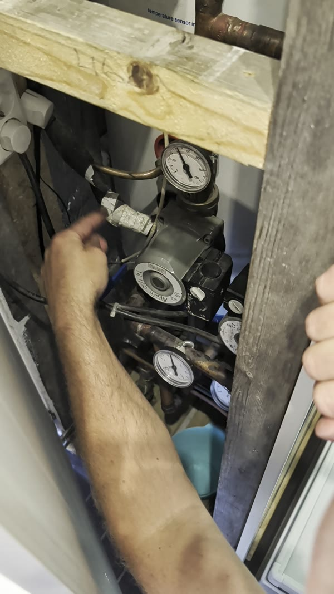
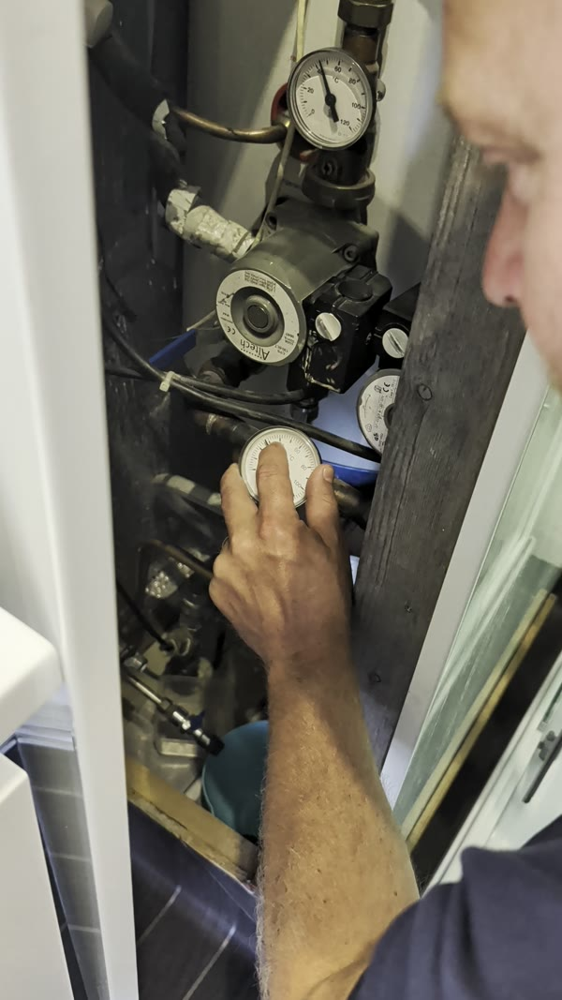
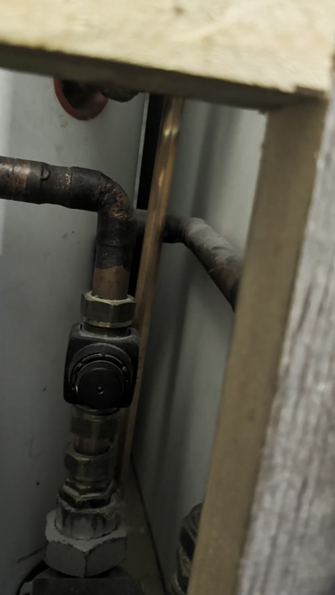
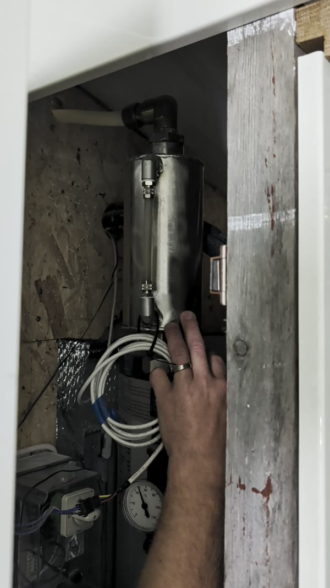
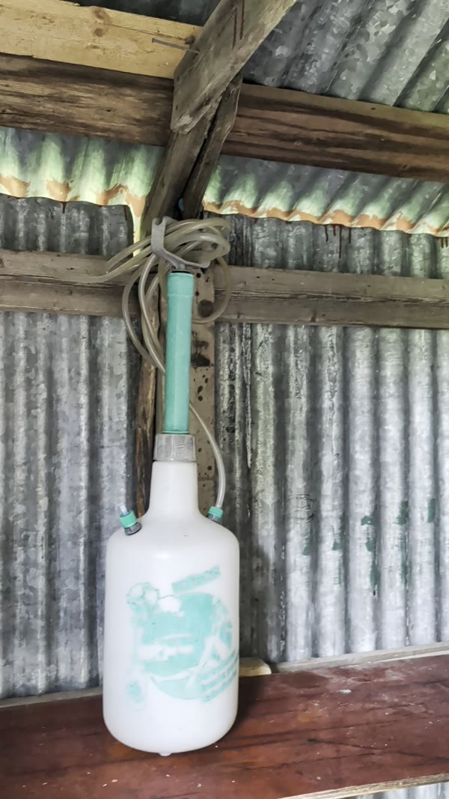
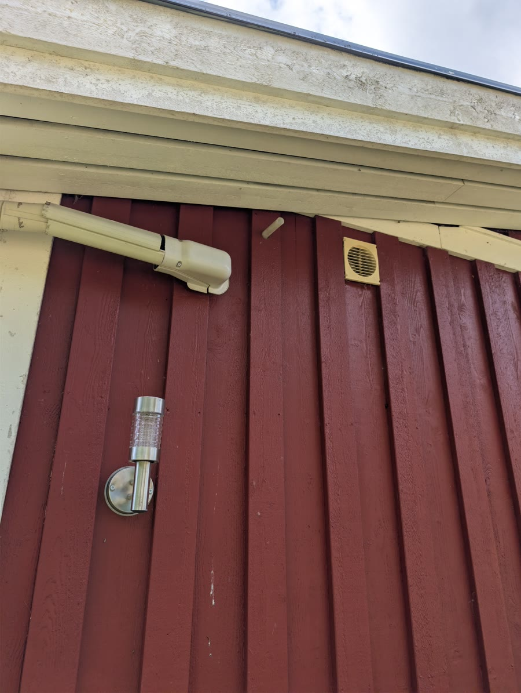

Plats: I badrummet, bakom panelen.

Guide till luftvarmvattenberedaren i badrummet: hur man ställer in temperaturen, hur man får extra varmvatten, hur golvvärmen fungerar, hur man fyller på glykol och hur man stänger av inför vintern.

## Ställa in temperaturen

Temperaturen ställs in på displayen på väggen i badrummet.

- **60 grader** är max. Tobias har alltid kört den på 60 grader och aldrig brytt sig om timer och liknande inställningar.
- I början av sommaren, eller när man inte behöver så mycket varmvatten, finns det ingen anledning att köra på 60 grader. Sänk till exempel till **40 grader**, eller stäng av den.

## Extra varmvatten ("turbo")

I systemet sitter en platt värmeväxlare (det isolerade, silverfärgade paketet bakom panelen). Den värmer vattnet mycket fortare än vad tanken gör.

När många ska duscha, på kort tid:

1. Slå på värmeväxlaren (läge **1**). Den börjar jobba direkt och värmer vattnet.
2. Temperaturmätaren går då upp över 60 grader, ända upp till cirka 70 grader.
3. **Kom ihåg att slå av den** när ni är klara.

::: {.callout-warning}
## Låt den inte stå på
Värmeväxlaren drar mycket energi. Den är tänkt som en liten turbo när man behöver extra varmvatten, inte som något som ska gå hela tiden.
:::

## Elpatronen

Ovanpå tanken sitter ett vred för elpatronen. Det klickar när man vrider på det. Det brukar stå på ungefär **60 grader**.

Om luftvarmvattenberedaren inte klarar att hålla 60 grader i systemet slår elpatronen till och hjälper till. Vid normal användning behöver man inte röra den.

## Värmekabeln under huset

Under huset finns en värmekabel som går ner till filtret, se [Värmekabeln](värmekabel.qmd). Om det kommer vatten i köket men inte i badrummet när det är kallt behöver vattnet i ledningen till badrummet värmas upp. Kör då värmekabeln en stund, cirka 5 minuter till en kvart.

## Golvvärmen

Golvvärmen har två kablar som sitter ihop. När man sätter i kontakten börjar cirkulationspumparna pumpa ut varmt vatten i golvslingorna. Man hör när den startar.

- Slangarna i golvet sitter fastklickade i plåtar under hela stugan, och det är plåtarna som sprider värmen.
- Det tar tid innan plåtarna värms upp. Räkna med att golvvärmen behöver gå **något dygn** innan man känner att golvet blir varmt.
- Pumparna går att ställa på högre fart, men det behövs inte.

::: {.callout-note}
## När behövs golvvärmen?
När golven är kalla, till exempel på hösten eller tidigt på våren. På sommaren behövs den inte. Då är det bara resursslöseri.
:::

### Stig och retur

Två temperaturmätare visar hur varmt vattnet i golvvärmen är:

- **S** (stigledning): vattnet som skickas ut i golvet.
- **R** (returledning): vattnet som kommer tillbaka, till exempel runt 28–30 grader.

### Justera temperaturen

En liten ratt (shunt) styr vilken temperatur som skickas ut i golvvärmesystemet.

1. Vrid ratten **väldigt lite** åt gången.
2. Vänta, och kolla mätarna för S och R ungefär var tionde minut för att se vad som händer.
3. Känn efter om golvet är lagom varmt, till exempel när du kliver upp på morgonen. Justera lite till om det behövs.

Det handlar om att prova sig fram. Skillnaden mellan ett golv som är 10 grader och ett som är 20 grader känns stor.

## Glykol

Systemet innehåller en blandning av vatten och glykol.

### Kontrollera nivån

Glykolbehållaren sitter högst upp bakom panelen i badrummet.

Hör man att det **bubblar** i systemet är det för lite glykol, och då behöver man fylla på. Att man inte ser någon vätska eller nivå i behållaren betyder inte att den är tom.

### Fylla på glykol

Påfyllningen görs utifrån med en tryckspruta (glykolpåfyllaren).

1. Köp färdigblandad glykol, **50/50 vatten och glykol** (finns till exempel på ICA).
2. Häll blandningen i påfyllaren och pumpa upp tryck i den.
3. Stick in slangen i det lilla plaströret som sticker ut under takfoten på husets utsida.
4. Stå på backen och pumpa, så att det rinner in.
5. Ta gärna hjälp av någon som står inne och tittar på behållaren och säger till när nivån är rätt. Nivån ska stiga lite grann när man pumpar.

::: {.callout-tip}
## Hur ofta?
Tobias har kollat över glykolen ungefär **en gång per år**.
:::

## Inför vintern

1. Slå av brytaren på husets utsida. Den sitter direkt på andra sidan väggen från luftvarmvattenberedaren.
2. Ställ gärna in ett litet element på lägsta nivån på golvet i badrummet över vintern.
3. Häll glykol i vattenlåsen, se [Vattenstugan](vattenstugan.qmd#glykol-vattenlas).
