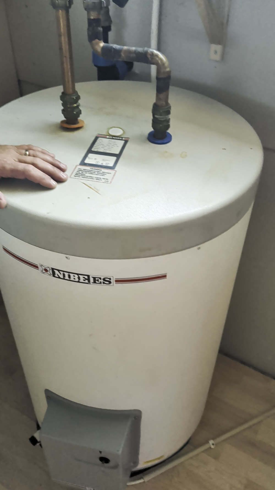
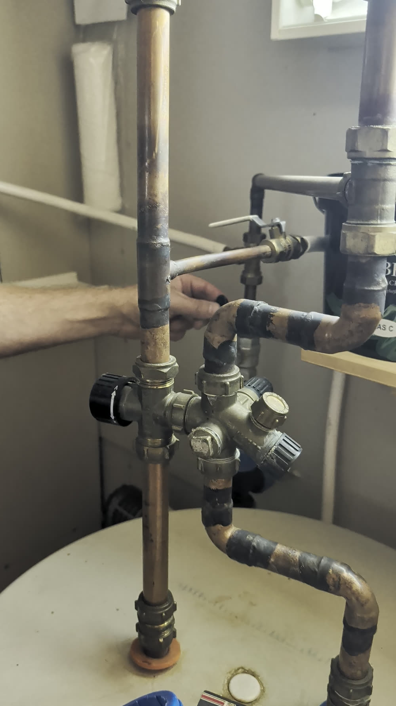
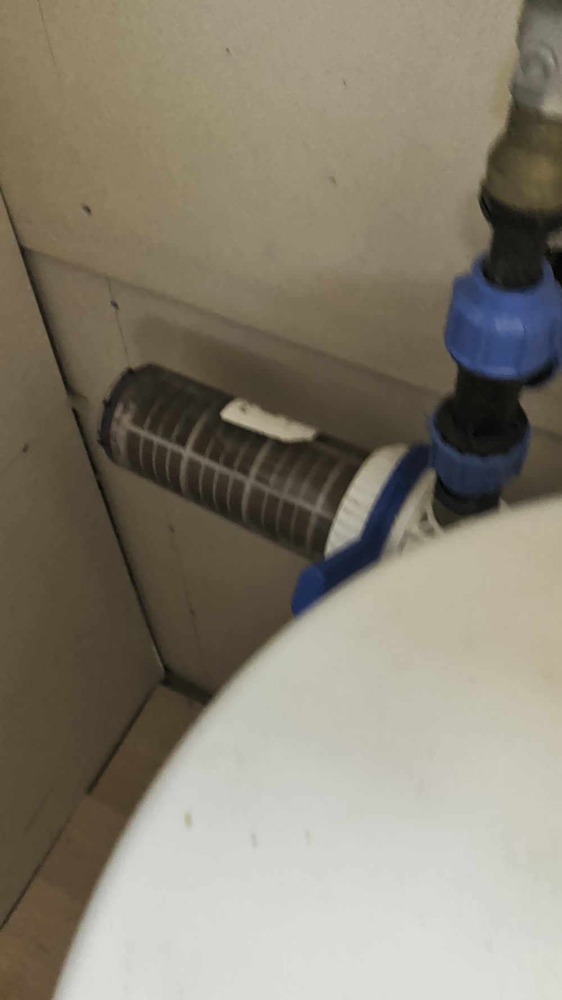
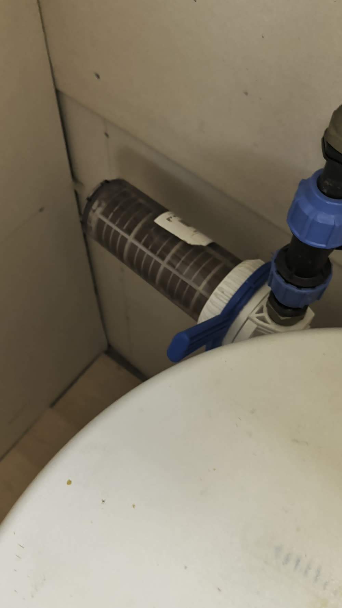

Guide till varmvattenberedaren under stugan: hur man stänger av vattnet och hur man sköter om vattenfiltret.

## Stänga av vattnet

Avstängningsventilen sitter ovanpå varmvattenberedaren, på röret som går ut till huset. Vredet visas på bilden med vita handtaget.

- Vrider man vredet så det är tvärs emot röret är vattnet **avstängt**.
- I öppet läge följer vredet med ledningen rakt fram.

När ventilen är avstängd släpps inget vatten ut till:

- **ventilen vid badtunnan** som sitter på väggen utomhus, och
- **kallt och varmt vatten till köket** (de två ledningar som går vidare från beredaren).

Med andra ord: stänger man den här ventilen är hela husets vattenförsörjning från beredaren avstängd.

## Vattenfiltret

Ledningen har ett grovfilter innan vattnet går vidare i systemet. Filtret sitter i ett hus med ett blått spärrhandtag, se bild.

Filtrets uppgift är att fånga upp grus och andra grova partiklar som annars följer med vattnet, särskilt precis när man släpper på vattnet igen efter att det varit avstängt.

### Så här sköter man filtret

1. Stäng av vattnet på huvudventilen (se ovan) innan filtret öppnas.
2. Skruva loss filterhuset (det blå handtaget/kopplingen).
3. Rengör filtret, eller byt ut det mot ett nytt — ett reservfilter finns tillgängligt att sätta i.
4. Skruva tillbaka filterhuset.

::: {.callout-note}
## Underhåll
Filtret bör bytas eller rengöras **en gång per säsong**, i samband med att vattnet stängs av inför vintern (eller spolas rent då).
:::

## Övrigt

Systemet i övrigt sköter sig själv utan vidare underhåll.
