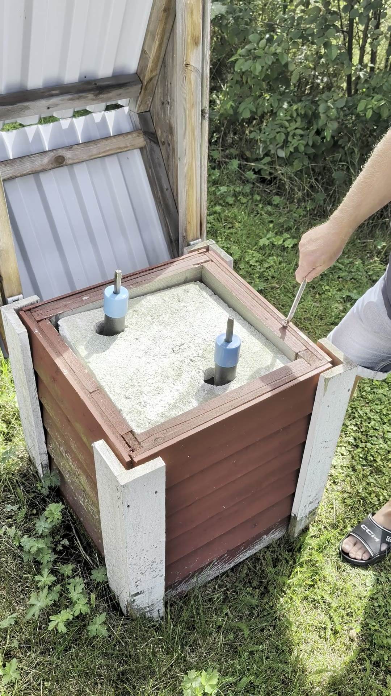
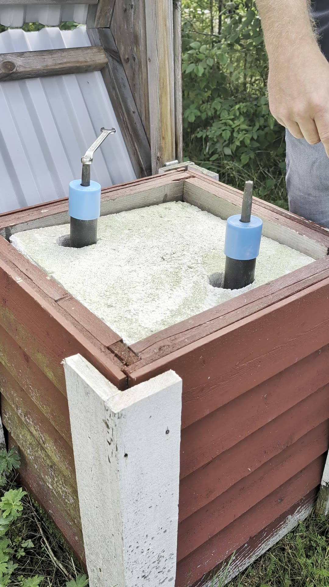
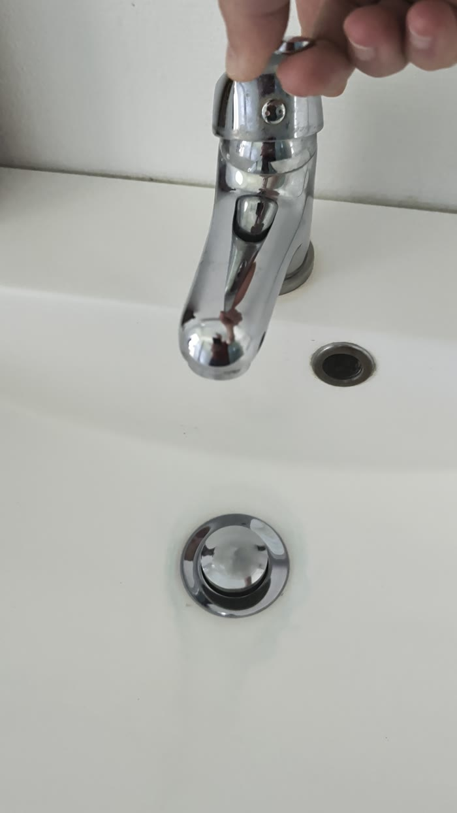
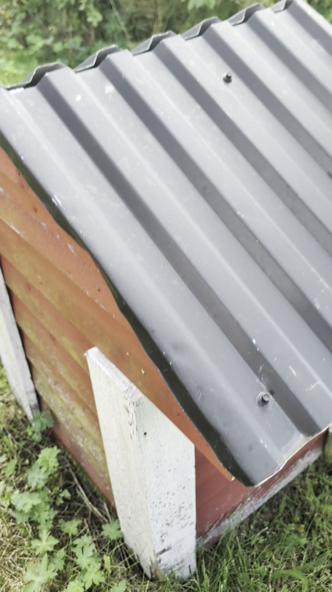

Guide till vattenstugan på tomten: hur man stänger av vattnet till stugan, tömmer ledningarna inför vintern och hur man slår på vattnet igen.

## Ventilerna

I vattenstugan sitter två avstängningsventiler som sticker upp ur gruset, båda med blå isolering runt röret.

- **Ventilen närmast stugan** är vår och styr vattnet till vår stuga.
- **Den andra ventilen** går till grannstugan (sidostugan). Den ska man inte röra.

## Stänga av vattnet (inför vintern)

1. Öppna locket på vattenstugan.
2. Sätt ventilnyckeln på vår ventil och vrid medurs för att öppna.
3. När ventilen är öppen börjar vattnet i ledningarna att rinna ut. Det hörs att det rinner.
4. Gå in i stugan och **öppna alla kranar**. Då rinner allt vatten ut ur fastighetens ledningar och vidare ut i samfällighetens uppsamlingsområde.

### Öppna kranarna i stugan

1. Lyft upp spaken på kranen så att den står helt öppen. Det bubblar i kranen när luft kommer in och vattnet rinner undan. Det går ganska snabbt.
2. Vrid spaken fram och tillbaka mellan varmt och kallt några gånger, så att både varm- och kallvattenledningen töms.
3. Lämna kranen **öppen** över vintern.
4. Gör likadant med alla kranar i stugan.

::: {.callout-tip}
## Varför ska kranarna vara öppna?
Med öppna kranar kan luft komma in och vattnet rinna ut ur ledningarna. Ledningarna töms då helt, så att inget vatten står kvar och fryser under vintern.
:::

### Glykol i vattenlåsen {#glykol-vattenlas}

När vattnet är avstängt för vintern: häll lite glykol i alla vattenlås, dvs. i **toaletten**, **duschen**, **handfatet** och **diskhon i köket**. Då står det glykol i vattenlåsen i stället för vatten, så att de inte fryser sönder.

::: {.callout-important}
## Glöm inte
Gör det här varje gång vattnet stängs av inför vintern, efter att ledningarna har tömts.
:::

## Sätta på vattnet igen

1. Stäng alla kranar i stugan.
2. Sätt ventilnyckeln på vår ventil och vrid moturs för att stänga ventilen.
3. Trycket byggs upp i ledningen. Vrid sedan ventilen **ända i botten**, lite längre än man tror.

::: {.callout-warning}
## Lyssna efter flöde
Lyssna efter ett porlande ljud. Om det fortfarande låter som att vatten flödar är ventilen inte helt stängd. Då släpps en del av vattnet ut via dräneringen i stället för att gå till stugan, och det kan bli en vattenpöl vid vattenstugan.
:::

## Avsluta

Lägg tillbaka locket på vattenstugan när du är klar.

