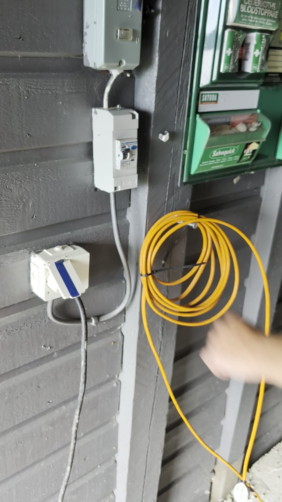
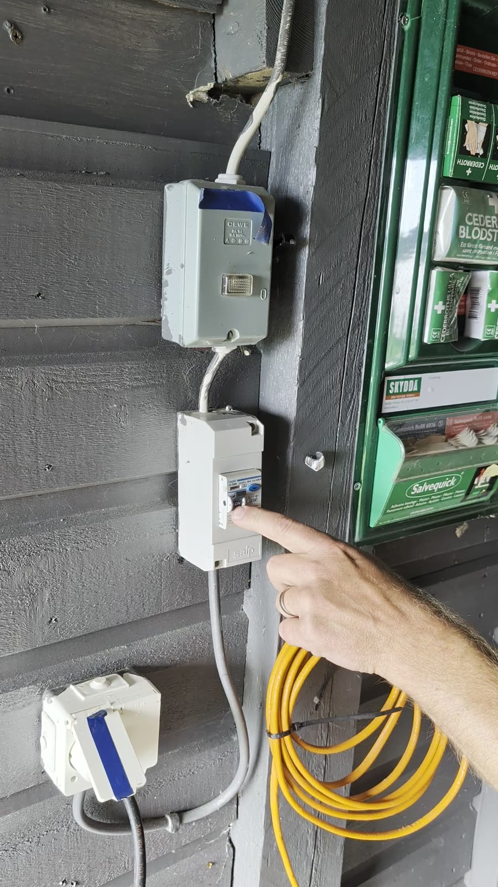

Plats: Under altanen.

Värmekablarna ligger längs vattenledningarna och värmer upp dem. Det finns två kablar:

- **Svart kabel**: till **huvudstugan**. Det är den här som används.
- **Orange kabel**: till **gäststugan**. Den behöver inte användas förrän ni har bestämt vad ni ska göra med gäststugan.

Kablarna kopplas in i ett uttag på väggen, och kretsen har en egen jordfelsbrytare.

## När behövs den?

När det är minusgrader kan vattenledningen frysa. Märker man det genom att man vrider på kranen ute men inget vatten kommer, då är det dags att köra värmekabeln.

## Så här tinar man upp ledningen

1. Kontrollera att jordfelsbrytaren är påslagen (spaken **uppåt**, läge **1/On**).
2. Koppla in den svarta värmekabeln i uttaget och slå på det.
3. Låt kabeln vara på i ungefär **en kvart**.
4. Stäng av och vänta en stund.
5. Slå på igen i ytterligare cirka **fem minuter**.

Därefter brukar vattnet vara uppe igen. Det går fort.

## Jordfelsbrytaren

- Spaken **uppåt** = påslagen.
- Spaken **nedåt** = avslagen (eller utlöst).

::: {.callout-tip}
## Testa jordfelsbrytaren
Jordfelsbrytaren har en testknapp. Tryck på den då och då för säkerhets skull. Spaken ska då slå ifrån (gå nedåt). Slå sedan på den igen.
:::
